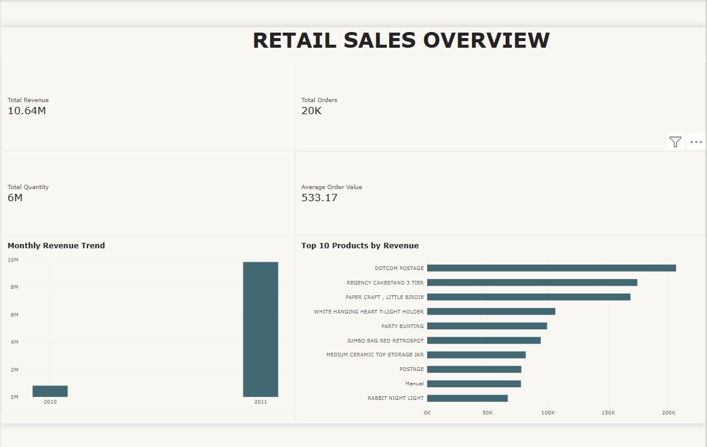
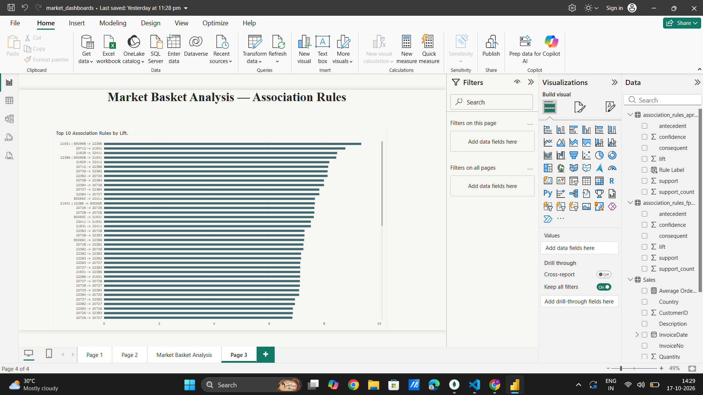
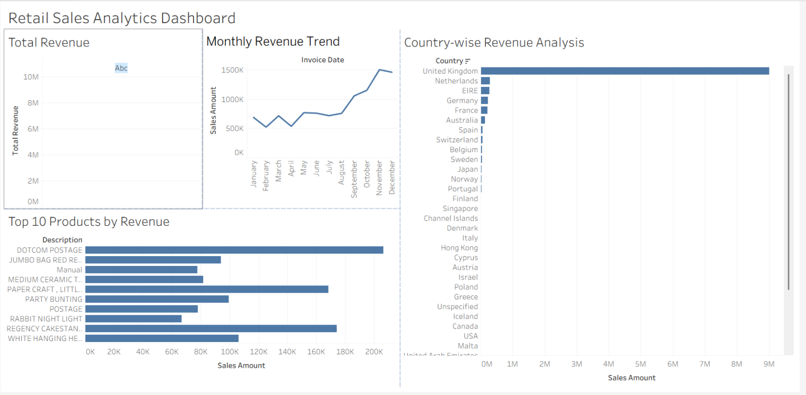
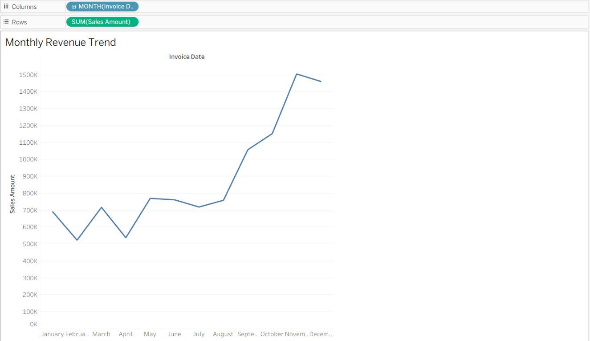
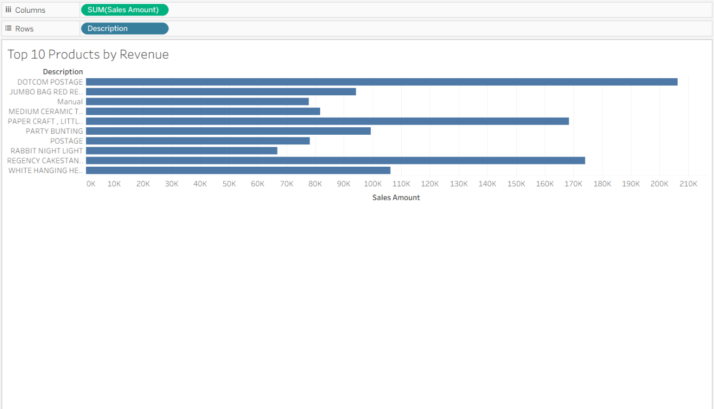
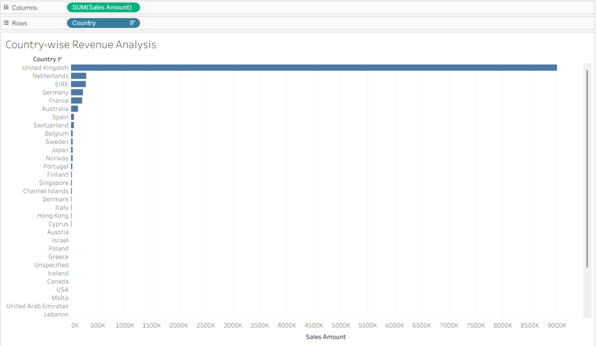

# Retail Sales and Market Basket Analytics

An end-to-end retail analytics project using the Kaggle/UCI Online Retail
transaction file. Python cleans the invoice lines, summarizes sales, and mines
product associations with Apriori and FP-Growth. Cleaned records and analysis
outputs can be imported into a local MongoDB database and consumed by BI tools.

## Project objectives

- Clean retail transaction data with explicit, reproducible rules.
- Analyze sales revenue, invoices, products, time periods, and countries.
- Compare Apriori and FP-Growth on the same invoice-level baskets.
- Store cleaned sales and mining results in local MongoDB and run aggregation
  queries.
- Present sales and product-association findings in Power BI and Tableau.

## Technologies

- Python 3, pandas, matplotlib, PyMongo
- Apriori and FP-Growth market-basket algorithms
- MongoDB Community Server (local development)
- Power BI Desktop and Tableau (desktop authoring)
- CSV for portable input and analysis exports

## Dataset

Place the downloaded CSV at:

```text
data\raw\Online_Retail.csv
```

The inspected source has 541,909 rows and includes `InvoiceNo`, `StockCode`,
`Description`, `Quantity`, `InvoiceDate`, `UnitPrice`, `CustomerID`, and
`Country`. The file is Windows-1252 compatible. The loader tries UTF-8 with
BOM first and Windows-1252 second.

The raw source is preserved. Do not commit raw or cleaned customer transaction
data to a public repository unless its license, privacy implications, and
redistribution terms permit it.

## Cleaning and analysis rules

`src\data_preprocessing.py` writes a separate cleaned CSV and JSON quality
report. It:

- Requires invoice/product identifiers, parseable dates, numeric quantity,
  and numeric unit price.
- Keeps rows with missing `Description`, `CustomerID`, or `Country`; customer
  IDs are not required for sales or basket analysis.
- Excludes cancelled invoices (invoice number begins with `C`), duplicate
  normalized source rows, invalid dates/numbers, zero quantities, and
  non-positive prices.
- Retains negative-quantity positive-price rows as returns in sales data.
  Returns reduce net revenue and units, but are excluded from product baskets.

Market-basket transactions are invoice numbers; items are distinct `StockCode`
values on positive-quantity lines. The current analysis uses minimum support
0.02 and minimum confidence 0.30. Support is the fraction of eligible invoices
containing an itemset. Association indicates co-occurrence, not causation.

## Setup and run (Windows PowerShell)

From the project directory:

```powershell
Set-Location 'C:\Users\garik\OneDrive\Documents\Desktop\market_basket_analysis'
python -m pip install -r requirements.txt
```

Clean the raw input:

```powershell
python -m src.data_preprocessing
```

If the cleaned CSV and quality report already exist, inspect them first. To
intentionally replace those generated files:

```powershell
python -m src.data_preprocessing --overwrite
```

Run sales and market-basket analysis:

```powershell
python -m src.run_analysis --min-support 0.02 --min-confidence 0.30
```

The analysis command refuses to replace existing results by default. After
reviewing them, use `--overwrite` to intentionally rerun:

```powershell
python -m src.run_analysis --min-support 0.02 --min-confidence 0.30 --overwrite
```

Run the tests:

```powershell
python -m unittest discover -s tests -v
```

The latest verified test run passed all 9 tests, including cleaning rules,
algorithm parity, MongoDB import behavior, and analysis output generation.

## Generated Python outputs

Cleaning creates:

```text
data\processed\cleaned_online_retail.csv
data\processed\data_quality_report.json
```

Analysis writes under `outputs\uci_online_retail\`:

- `sales_summary.csv`, `sales_by_month.csv`, `sales_by_country.csv`,
  `sales_by_product.csv`
- `frequent_itemsets_apriori.csv`, `frequent_itemsets_fpgrowth.csv`
- `association_rules_apriori.csv`, `association_rules_fpgrowth.csv`
- `algorithm_comparison.csv`
- `sales_by_month.png`, `top_products_by_sales.png`,
  `algorithm_comparison.png`

These are generated files; rerun the analysis to regenerate them. The
repository currently ignores files under `outputs/`.

## MongoDB integration

The importer is deliberately scoped to unauthenticated MongoDB on loopback and
the local database `RetailAnalytics`. It rejects remote/Atlas URIs.

```powershell
python -m src.mongodb_integration --check
python -m src.mongodb_integration --import-data
python -m src.mongodb_integration --run-queries
```

Collections: `sales_records`, `transaction_summaries`, and
`market_basket_results`. Imports use stable IDs, batch upserts, and count
verification. MongoDB Server must be running; MongoDB Compass is optional. See
[mongodb/README.md](./mongodb/README.md) for setup, collection details, and
example monthly revenue, product, invoice-count, and rule queries.

## Dashboards

### Power BI

Connect to `data\processed\cleaned_online_retail.csv` as the line-level Sales
table and import
`outputs\uci_online_retail\association_rules_apriori.csv` separately for the
association-rules table. Exact data types, relationships, DAX, visual setup,
and validation are documented in
[dashboards/power_bi/README.md](./dashboards/power_bi/README.md).

The supplied Power BI sales-overview screenshot shows revenue, orders,
quantity, average order value, a revenue trend, and top products:



In the supplied overview image, the revenue trend's visible axis shows 2010
and 2011 rather than individual months. Verify the date hierarchy is set to
month level in Power BI Desktop before presenting it as a monthly trend.

The supplied Power BI market-basket screenshot shows an association-rules page
with rules ranked by lift:



No `.pbix` file is included, so the interactive report cannot be opened or
independently verified from this repository snapshot.

### Tableau

The supplied Tableau screenshots show a sales dashboard, a monthly trend,
top-product worksheet, and country revenue worksheet:









The project owner reports completing and publishing the Tableau Public
dashboard. The supplied dashboard screenshot visibly shows `Abc` in its Total
Revenue pane rather than a KPI value. If the published workbook has since been
corrected, replace this older screenshot with a current export; screenshots
cannot verify the current published state. The top-product view includes
`DOTCOM POSTAGE`; treat postage and other non-merchandise codes separately
when making retail product recommendations. No `.twb`/`.twbx` workbook or
Tableau Public URL is included, so workbook calculations, filters, and
interactions could not be independently inspected.

## Verified findings from current analysis exports

The latest inspected analysis outputs show:

- 541,909 source rows; 524,878 cleaned invoice lines.
- 19,960 invoices and 3,922 distinct product codes.
- Net revenue of 10,642,110.804 and 5,572,420 positive units sold.
- The cleaned file contains no return lines; therefore current gross and net
  revenue totals are equal.
- The United Kingdom has the largest country revenue in this export:
  9,001,744.094 across 18,019 invoices.
- November 2011 is the highest-revenue month in the available period:
  1,503,866.78 across 2,769 invoices.
- Product code `DOT` (`DOTCOM POSTAGE`) has the highest net revenue
  (206,248.77). It is a postage line, so do not treat it as an ordinary retail
  product without an explicit business decision.
- Product code `23843` (`PAPER CRAFT , LITTLE BIRDIE`) has the highest positive
  quantity (80,995 units).
- At the current thresholds, each algorithm produced 385 frequent itemsets
  and 164 association rules on 19,960 baskets.
- One top-lift Apriori rule is `22697 | 22699` -> `22698`, with support count
  541, support about 2.71%, confidence about 70.53%, and lift about 18.40.
  Treat this as an association to investigate, not a causal effect.

These figures are from the current files under `outputs\uci_online_retail\`;
they are not forecasts or universal business conclusions. Validate them again
if the source, cleaning rules, or thresholds change. The author should add
only recommendations supported by further product, operational, and
commercial context.

## Business recommendation considerations

- Review high-revenue and high-volume products separately; revenue ranking and
  unit ranking are not the same.
- Investigate monthly peaks with additional years and operational context
  before making staffing or inventory changes.
- Use country revenue to prioritize further market research, not to infer
  profitability; costs and market size are not included.
- Treat association rules as hypotheses for controlled placement or promotion
  tests. Measure outcomes before claiming bundle lift or causal impact.
- Review postage and other non-merchandise codes separately from retail
  products.

## GitHub preparation

This folder was not detected as a Git repository during the latest inspection.
The `.gitignore` excludes raw/processed data, generated outputs, secrets,
virtual environments, caches, and embedded BI workbook/extract files. The
dashboard screenshots are intentionally kept for the portfolio README.

After reviewing the ignore rules and checking that the screenshots may be
shared, initialize and inspect Git locally:

```powershell
Set-Location 'C:\Users\garik\OneDrive\Documents\Desktop\market_basket_analysis'
git init
git status --short
git check-ignore -v data\raw\Online_Retail.csv data\processed\cleaned_online_retail.csv outputs\uci_online_retail\sales_summary.csv
git status --short --untracked-files=all
```

The first two data files and generated output should be ignored; source code,
documentation, requirements, and dashboard screenshots should remain eligible
for review. Create an **empty** GitHub repository using your own account, then
replace the placeholder URL below with its HTTPS URL:

```powershell
git add .gitignore README.md requirements.txt src tests mongodb excel powerbi tableau dashboards screenshots
git status --short
git diff --cached --stat
git diff --cached
git commit -m "Prepare retail analytics project for GitHub"
git branch -M main
git remote add origin https://github.com/<YOUR_USERNAME>/<YOUR_REPOSITORY>.git
git push -u origin main
```

Before `git commit`, inspect the staged diff and verify no raw/processed
datasets, credentials, `.env` files, machine-specific configuration, or
unintended generated outputs are staged. Do not use `git add .` until this
check is complete. These commands are instructions only; no repository was
initialized and nothing was committed or uploaded during this task.

## Author

Add your name and GitHub profile link here.
